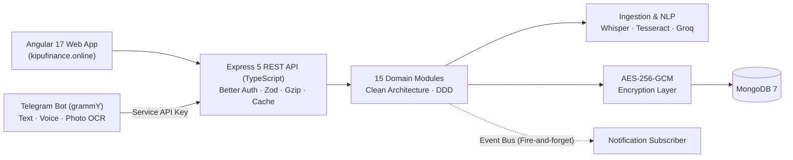

# Kipu — Personal Finance Platform

Production personal finance platform live at **[kipufinance.online](https://kipufinance.online)**, combining an Angular web dashboard with automated multi-channel expense capture (Telegram text, voice notes, receipt OCR, and bank CSV imports) and application-level `AES-256-GCM` encryption.

This repository hosts the **Angular 17 web application**. The production REST API and Telegram bot run as independent backend services documented below.

---

## System Architecture & Security

> **Backend & Bot repository visibility:** The production REST API (`Finance-Tracker-Backend`) and Telegram bot (`Bot-Finance`) repositories are kept **private** to protect live user data, credentials, and operational security for [kipufinance.online](https://kipufinance.online). A full architecture and code walkthrough is available upon request during technical interviews.



### Production Services Breakdown

| Service | Visibility | Core Stack | Responsibilities |
| :--- | :---: | :--- | :--- |
| **Kipu Web (`Kipu`)** | Public | `Angular 17.3` (standalone + signals), `TypeScript`, `Tailwind CSS`, `ECharts`, `RxJS`, `Nginx/Docker`, `Vercel` | Financial dashboard, transactions, categories, pockets, goals, analytics, AI insights, subscriptions & auth UI |
| **REST API (`Finance-Tracker-Backend`)** | Private | `Node.js`, `Express 5`, `TypeScript`, `MongoDB 7` / `Mongoose 8`, `Zod 4`, `Better Auth` | 15 isolated business domains (Hexagonal Clean Architecture / DDD), dual auth (session cookies + service API keys), `AES-256-GCM` encryption (random & deterministic IV modes), user-scoped response caching (`node-cache`, 60 s TTL + invalidation on writes), gzip compression, banking CSV adapters (`Bancolombia`, `Nequi`, `Davivienda`, `Nu`) + Twilio SMS webhook, event-driven non-blocking notifications |
| **Telegram Bot (`Bot-Finance`)** | Private | `TypeScript` (ESM), `grammY`, `MongoDB`, `Sharp`, `Tesseract.js`, `Groq (Llama 3.1 8B)` | Natural-language expense capture, receipt OCR with Colombian bank detection, voice-note forwarding (Whisper + NLP), 6-digit web-account linking (`TelegramLink`), daily/weekly/monthly reports & pocket alerts |

---

## Web Application Structure

```text
src/app/
├── core/                  # Auth, API services, interceptors, guards & domain models
├── features/
│   ├── dashboard/         # Financial overview & KPI cards
│   ├── transactions/      # Multi-origin transaction history & forms
│   ├── analytics/         # Monthly trends, projections, anomalies & breakdowns
│   ├── ai-insights/       # AI-generated spending insights
│   ├── insights/          # Actionable financial summaries
│   ├── pockets/           # Budget pockets & spending limits
│   ├── goals/             # Savings goals & projections
│   ├── categories/        # Custom & default income/expense categories
│   ├── subscription/      # Free / trial / premium tier flows
│   ├── auth/              # Email/password & Google OAuth views
│   ├── landing/           # Public landing page
│   ├── profile/           # User profile & Telegram account linking
│   ├── referral/          # Referral flows
│   └── settings/          # User preferences
└── shared/                # Reusable UI components & animations
```

---

## Local Development (Frontend)

### Prerequisites
- Node.js 20+
- `pnpm` (`9.x`)

### Commands

```bash
# Install dependencies
pnpm install

# Run development server (http://localhost:4200)
pnpm start

# Run unit tests (Karma + Jasmine)
pnpm test

# Run headless CI tests with coverage
pnpm run test:ci

# Production build
pnpm run build
```

Environment configuration lives under `src/environments/` (`environment.ts` and `environment.prod.ts`), pointing to the REST API base URL.
